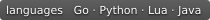

<div align="center">

[English](README.md) | [中文](README.zh.md)

<p align="center"> </p>

# Hello Redis

<p align="center">
  
  
  
  
</p>

Redis 开发者笔记 · [在线浏览](https://cuihairu.github.io/hello-redis/)

</div>

---

这里记录 Redis 基础数据类型、Lua 脚本、持久化与高可用、开发集成、运维管理和源码分析中的实践与观察。

索引：[知识点总纲](https://cuihairu.github.io/hello-redis/knowledge)——核心概念、书籍与官方文档要点、应用场景与常见坑，逐条链接到相关记录。

## 本地开发

```bash
npm install          # 安装依赖
npm run docs:dev     # 本地开发
npm run docs:build   # 构建到 docs/.vitepress/dist
npm run docs:preview # 本地预览构建产物
```

## License

本作品采用 [Creative Commons Attribution 4.0 International (CC BY 4.0)](https://creativecommons.org/licenses/by/4.0/) 许可协议发布。
